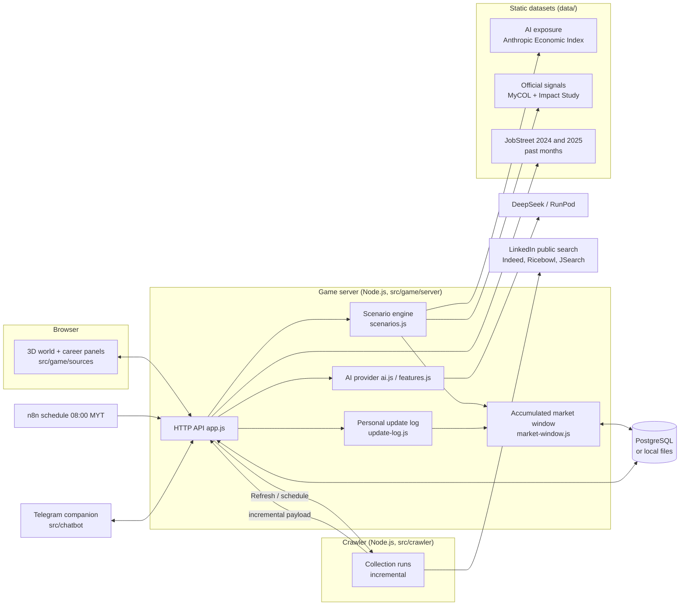

# KerjayaKu: system overview

This page describes the whole system as it is meant to work for the SDC XMUM Hack 2026 final, and marks which parts
are built and which are not. It is separate from the project [README](../README.md), which stays the submission guide.

Status as of 2026-10-30 (evening). Legend: ✅ built and tested · 🟡 partly built · ⬜ not started · ⏸ waiting on a decision or a person.

---

## 1. What the system does

A student explores careers in a 3D world. The system compares their skill profile with what Malaysian job postings ask
for, ranks careers under two AI-adoption scenarios, and builds a learning roadmap whose core does not depend on which
scenario comes true. Every market figure on screen comes from collected postings or an official source; where there is
no data, the screen says so.

## 2. Architecture

| Process | Path | Started by | Status |
|---|---|---|---|
| Game server and API | `src/game/server` | `npm run server` (local), `npm run server:cloud` (Replit) | ✅ |
| Browser client | `src/game/sources` | Vite (`npm run dev`, `npm run build`) | ✅ |
| Crawler service | `src/crawler` | as a child of the game server in the cloud (`start-with-crawler.js`), or `npm start` locally | ✅ |
| Telegram companion | `src/chatbot` | separate FastAPI process | ✅ (unchanged in this round) |
| n8n workflows | `src/game/n8n`, `src/crawler/n8n` | n8n instance | 🟡 defined, not yet deployed |

## 3. Data sources

Authored market numbers (fixed heat 80/60/30, hand-written trends, demo months) were removed on 2026-10-30.

**Exception, by the team's decision on 2026-10-30:** only months our own collection reached are real; every other
month of the market panel is **simulated**, in the same unit (postings): the heatmap's empty cells, and the history
behind the ranking and the skill trends, so they show rises and falls (`src/game/sources/Career/MockMarketHistory.js`:
a fixed, repeatable path per career and per skill anchored on its latest real value). They are not labelled on
screen; heatmap cells carry `data-origin="mock"`. The JobStreet months are no longer mixed into the heatmap. The
scenario model, the update log and the 2024→2025 change never read simulated values. Careers we have not collected yet (the 8 added ones) also show simulated values in the latest month.

| Source | What it gives | Where | Used for | Status |
|---|---|---|---|---|
| Collected postings: LinkedIn public search (Indeed and Ricebowl when they allow access; JSearch when a key is set) | Postings per career, described postings, skill mentions | crawler → `data/crawler/market-window.json` or PostgreSQL | Heatmap (this year), skill shares, skill momentum, update log | ✅ |
| FDE archived postings (OpenJobData) | FDE postings for Jul–Sep 2026 | `src/data/historical/fde_2026` | Heatmap cells for FDE | ✅ |
| DOSM and Techmap monthly totals | National online job ads, all careers together | `src/data/historical/2026-04_onwards` | "Historical market total" chart only | ✅ |
| JobStreet Malaysia 2024 (Hugging Face `azrai99/job-dataset`, CC BY 4.0) and 2025 (`seemarn/jobstreet`, no licence stated) | 56,307 postings collected 2024-02-22 to 06-20, and 9,554 from 2025-03-04 to 05-08 (only the collection window: older adverts still open are left out), sorted with the crawler's own rules | `data/reference/jobstreet-2024`, `jobstreet-2025` (aggregates only; raw files not in git) | Heatmap months, as the share of each month's sample on their own colour scale; career selection | ✅ |
| JobStreet 2024→2025 change | Shares in the same dates of both years (03-04 to 05-08), adjusted for the JobStreet category mix; skills as a share of all skill mentions | `data/reference/jobstreet-yoy.json` | Last heatmap column "24→25", career page, skill cards. **Not used by the scenario model** (two points from different collectors; extrapolated over 3 years it ranked a chef above a software engineer for a data profile) | ✅ display only |
| Probe collection, Oct 2026 | LinkedIn counts for the candidate careers | `data/reference/probe-2026-10` (aggregates only) | Career selection | ✅ |
| MyCOL 2015/16–2024/25 and the Impact Study (TalentCorp) | Critical-occupation listings, emerging roles; each with page and quote | `data/official-signals/signals.json` | Career outlook, MyCOL record in the career page | ✅ |
| Anthropic Economic Index (CC-BY) | AI automation and augmentation per task, mapped to skills | `data/ai-exposure/exposure.json` | Scenario engine | 🟡 42 skills reviewed; 3 await review (api-integration, usability-testing, cad) |

What is **not** data and is labelled as such: scenario parameters (assumptions), skill difficulty, preparation months
and roadmap hours (estimates), and the guided tour's sample AI answers (demo mode).

## 4. Market data flow

1. **Collection.** The crawler searches each career, normalises every posting (`normalize.js`: title rules from
   `src/crawler/config/career-titles.json`, skill rules from `src/game/n8n/market/pipeline.js`) and sends the run to the
   game server.
2. **Incremental runs.** The game server tells the crawler what it already has (`since` and a fingerprint per listing),
   so a run fetches only new or changed postings and skips detail pages of unchanged ones.
3. **Accumulated window.** Postings are merged by platform and id into a 30-day window; monthly aggregates are kept for
   the current Malaysian month. A change of collection scope (careers or rules) starts the monthly records again.
4. **Triggers.** The daily schedule (08:00 Malaysia time, n8n) always runs. **Refresh** lets a player start a run early;
   it collects only what is new since the last run. Refresh is blocked for 30 minutes after any completed run.
5. **Views.** The window feeds the heatmap, skill shares, skill momentum and the personal update log.

## 5. Decision engine

### 5.1 Skill momentum (`skill-momentum.js`) ✅
Least-squares slope of log(skill share) per month, ×12. Needs at least 3 comparable months (same sources, at least 30
described postings). With fewer months the label is "current demand" and no trend is claimed. Today only one month is
comparable, so every skill reads "current".

### 5.2 Scenario model (`scenarios.js`) ✅
Two presets: moderate (k = 0.6) and fast (k = 1.6), horizon H = 3 years, τ = 5, β = 0.5.

- Adoption D = 1 − e^(−kH/τ) (≈ 0.30 moderate, ≈ 0.62 fast)
- Demand term T = clamp(e^(growth·H), 0.5, 2)
- Future value of a skill V = T × (1 − a·D) × (1 + β·u·D), with a = automation and u = augmentation from the AI exposure data
- Fit = Σ w·min(current, required)/required·V ÷ Σ w·V, with w = level × weight
- Outlook = clamp(mean V × career term − 0.5, 0, 1)
- **Score = round(100 × (0.6 × fit + 0.4 × outlook))**
- "How to raise it": gain per skill = 100 × 0.6 × w·V·gap/required ÷ Σ w·V, top 3 shown
- Labels: rising above 1.05, declining below 0.95

No personal attributes are used. Parameters are never tuned to force a different ranking.

API: `POST /api/scenario` (preset or k and H), `GET /api/forecast`; `view()` carries `forecast` and `scenarioCompare`.

### 5.3 No-Regret roadmap (`no-regret.js`) ✅ backend, ⬜ screen (prompt 04 section 5)
Built 2026-10-30. Gap skills that rank high under both scenarios form the **core**; the rest split into a
**moderate** and a **fast** branch; skills declining under both go **last**, with the reason. The order is computed in
code; the AI only writes the stage text. When new data changes the core or a branch, the roadmap shows
`replanSuggested`. Adds `chosenBranch` and an `alternative` status to the roadmap.

## 6. Player features

| Feature | Where | Status |
|---|---|---|
| Profile from free text or CV (AI) | Profile panel, `features.extractSkills` | ✅ |
| Career matching and skill gap | Careers panel | ✅ ranked by the scenario score |
| Roadmap with stages, tasks and resources | Roadmap panel | ✅ No-Regret order (core, branches, later) from the server; branch display ⬜ (prompt 04) |
| Market heatmap, rankings, skill trends | Market panel | ✅ real data only |
| Heatmap range: any "from" and "to" month, February 2024 to now (months without data marked) | Market panel | ✅ |
| Past JobStreet months and the 2024→2025 change | Market panel, career page, skill cards | ✅ |
| Refresh with timing (last, next, cooldown) | Market panel | ✅ |
| Personal update log ("changes that concern you") and learning direction | Server and API only (`update-log.js`, `/api/update-log`, `/api/learning-direction`); the card was removed from the market panel on 2026-10-30 | 🟡 |
| Learning direction → catalog skills (AI, keyword fallback in demo mode) | Market panel, `POST /api/learning-direction` | ✅ |
| MyCOL record per career (listed, not listed, not covered) | Career page | ✅ |
| Scenario switch (moderate / fast, always labelled estimate), rank change against the other scenario, low-confidence tag, thin-profile prompt | Careers panel (`ScenarioView.js`) | ✅ |
| Why this score (formula with the career's numbers, each skill's value and parts with sources, how to raise it), assumptions card, skill radar (rising, declining, declining under both) | Career page, careers panel, market skill tab | ✅ |
| "Data as of" month selector | Market panel | ⬜ prompt 04 |
| Roadmap branches and re-plan prompt | Roadmap panel | ⬜ prompts 03 and 04 |
| Career pet, learning logs, mentors, SDG links, three languages | throughout | ✅ (unchanged in this round) |

## 7. Storage

| Data | Cloud (Replit) | Local |
|---|---|---|
| Player save (versioned, save version 6) | PostgreSQL `game_saves` | `data/game/save.json` (not in git) |
| Market window | PostgreSQL `app_documents` | `data/crawler/market-window.json` |
| Market and trends documents (pushed by n8n) | PostgreSQL `app_documents` | `data/game/market.json`, `data/game/trends.json` |
| Crawler runs | SQLite inside the crawler | `src/crawler/data/market.sqlite` |

Backend order: AWS (if `AWS_BACKEND_URL` is set) → PostgreSQL (if `DATABASE_URL` is set) → files. Writes use optimistic
versions; a conflict is retried once. `npm run migrate:pg` copies the local data into an empty database and leaves
existing rows untouched.

## 8. Careers

22 careers: the original 14 and 8 added on 2026-10-30 from the data (prompt 01c). A candidate needed at least 50
postings in JobStreet 2025 and at least 10 on LinkedIn in October 2026.

| Added career | JobStreet 2025 | LinkedIn, Oct 2026 (floor) | MyCOL editions listing it | AI exposure |
|---|---:|---:|---|---|
| Accountant | 501 | ≥ 50 | 6 of 7 | ⏸ to review |
| Sales & business development | 691 | 42 | 4 | ⏸ to review |
| Human resources | 204 | 30 | 1 (managers are listed in more, not executives) | ⏸ to review |
| Software engineer | 151 | 39 | 7 | ⏸ to review |
| Customer service | 141 | 44 | none at executive level | ⏸ to review |
| Digital marketing | 105 | 27 | 5 | ⏸ to review |
| Quantity surveyor | 94 | 29 | 4 | ⏸ to review |
| Electrical & electronics engineer | 82 | 33 | 7 | ⏸ to review |

Not added: procurement & supply chain (passed, not chosen), business analyst and mechanical engineer (under 50 on
JobStreet).

How a career is built from the data:
- **Skills**: those named in at least 10% of its JobStreet 2025 postings (by the crawler's skill rules), most named
  first, up to 8; level and weight 3 when named in 60% or more, 2 from 30%, else 1. Clear mismatches are left out
  (auditing and social media for HR, recruitment for customer service). 20 skills were added to the catalog for them
  (67 in all), each with a free learning resource and an SDG target.
- **Title rule and search words** in `src/crawler/config/career-titles.json`, so the daily collection covers it.
- **AI exposure**: O*NET occupations in `data/ai-exposure/skill_task_map.json`. A career marked `reviewed: false`
  appears in the review sheet and the draft only; the values the game reads do not move until it is reviewed.
  Skills with no matching O*NET task (PLC & automation, social media, workplace languages) show "no source".
- **MyCOL evidence**: quoted from the PDF pages and checked by `import_official_signals.py`.

The daily collection with 22 careers, measured on the cloud profile (LinkedIn only): 53 requests and 145 seconds,
within the limits of 150 requests and 10 minutes. With a JSearch key set, it makes about 44 API calls a day.

## 9. Work remaining

| # | Work | Status | Depends on |
|---|---|---|---|
| 01b | Review of the last 3 AI exposure skills | ⏸ | Aloysius |
| 01c | AI exposure review of the 8 new careers and 20 new skills (`data/ai-exposure/REVIEW.md`) | ⏸ | Aloysius |
| 03 | No-Regret roadmap: done (server, routes, re-plan prompt, tests); with today's data both test profiles give one path (no fork) | ✅ | — |
| 04 | Scenario screens done; left: roadmap branches (needs 03), "data as of" selector (needs a snapshots API), slider and side-by-side bonus | 🟡 | 03 |
| 05 | Demo profile, end-to-end checks (local and deployed), demo script, Q&A, tools declaration | ⬜ | 03, 04, deployment |
| Deploy | Replit: create the database (production is created on the first publish when development has data), check Node ≥ 22.13 (the crawler asks for Node 24), push the branch, run the migration, publish, set up n8n | ⏸ | Commit and push approval; Replit owner |

## 10. Known limits

- **One comparable month.** Trends need three; until then skills show current demand only and confidence is low.
- **One live platform.** Indeed, Ricebowl and JobStreet answer with browser verification (HTTP 403), which is not
  bypassed. This year's postings come from LinkedIn.
- **Detail pages are capped** per run, so only part of the postings have descriptions for skill analysis.
- **JobStreet 2024 and 2025** come from another platform and from different collectors: their months are shares on their own colour scale, never joined to our counts. Their mix of JobStreet categories differs (2025 holds relatively more small categories) and the 2025 descriptions are about twice as long, so the 2024→2025 change is adjusted for the category mix and uses the share of skill mentions. Even so it is a change in the samples, not in the market, and the scenario model does not use it.
- **Weighting to DOSM** (prompt 01e): every posting is placed in one of four MASCO strata (managers, professionals, technicians and associate professionals, others) by title rules, then the AI for titles the rules cannot place; a review of 200 postings by Aloysius found 82.5% right (rules 87%, AI 75%), and the rules then took up the reviewer's conventions. Samples are weighted to DOSM's shares of their quarter (2024 Q2, 2025 Q1, 2026 Q2; DOSM releases only quote three groups, so the rest is one stratum, and 2024 Q1 and 2025 Q2 have no group figures). Margins are 95%, from Kish's effective sample size. The four strata barely move the JobStreet 2024→2025 comparison: the two datasets differ inside the strata (2025 holds more education, hospitality and construction postings), and the margins cover sampling error only, not the different collectors.
- **National estimate of our collection** (`server/national-estimate.js`): the window's real postings weighted to the latest DOSM quarter (title rules only at run time, since the AI answers are not deployed), shown on hover in the ranking and skill tabs with the 95% margin. With about 60 described postings the margins are wide (around ±14 points for a skill); they narrow as the daily collection grows.
- **AI exposure** reflects how people use Claude on US O*NET tasks: a signal of where AI enters work, not jobs lost and
  not Malaysian data.
- **MyCOL editions differ in scope** (2022/23 covered three sectors only); not being listed is never read as a decline.
- **Cloud crawler** runs in the same container as the game; on Replit's autoscaling target it may be throttled between
  requests, and more than one instance could poll at once.
