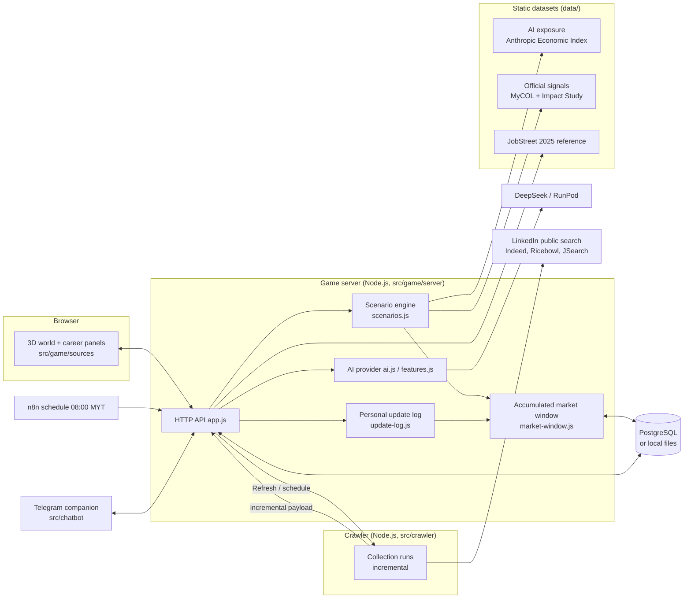

# KerjayaKu: system overview

This page describes the whole system as it is meant to work for the SDC XMUM Hack 2026 final, and marks which parts
are built and which are not. It is separate from the project [README](../README.md), which stays the submission guide.

Status as of 2026-10-30. Legend: ✅ built and tested · 🟡 partly built · ⬜ not started · ⏸ waiting on a decision or a person.

---

## 1. What the system does

A student explores careers in a 3D world. The system compares their skill profile with what Malaysian job postings ask
for, ranks careers under two AI-adoption scenarios, and builds a learning roadmap whose core does not depend on which
scenario comes true. Every market figure on screen comes from collected postings or an official source; where there is
no data, the screen says so.

## 2. Architecture

| Process | Path | Started by | Status |
|---|---|---|---|
| Game server and API | `src/game/server` | `npm run server` (local), `npm run server:cloud` (Replit) | ✅ |
| Browser client | `src/game/sources` | Vite (`npm run dev`, `npm run build`) | ✅ |
| Crawler service | `src/crawler` | as a child of the game server in the cloud (`start-with-crawler.js`), or `npm start` locally | ✅ |
| Telegram companion | `src/chatbot` | separate FastAPI process | ✅ (unchanged in this round) |
| n8n workflows | `src/game/n8n`, `src/crawler/n8n` | n8n instance | 🟡 defined, not yet deployed |

## 3. Data sources

Only real data reaches the screen. Authored market numbers (fixed heat 80/60/30, hand-written trends, demo months) were
removed on 2026-10-30.

| Source | What it gives | Where | Used for | Status |
|---|---|---|---|---|
| Collected postings: LinkedIn public search (Indeed and Ricebowl when they allow access; JSearch when a key is set) | Postings per career, described postings, skill mentions | crawler → `data/crawler/market-window.json` or PostgreSQL | Heatmap (this year), skill shares, skill momentum, update log | ✅ |
| FDE archived postings (OpenJobData) | FDE postings for Jul–Sep 2026 | `src/data/historical/fde_2026` | Heatmap cells for FDE | ✅ |
| DOSM and Techmap monthly totals | National online job ads, all careers together | `src/data/historical/2026-04_onwards` | "Historical market total" chart only | ✅ |
| JobStreet Malaysia 2025 (Hugging Face `seemarn/jobstreet`) | 9,566 postings, 2025-03-03 to 2025-05-08, sorted with the crawler's own rules | `data/reference/jobstreet-2025` (aggregates only, raw file not in git; the dataset states no licence) | Heatmap months Mar–May 2025, shown only when the chosen range reaches them, with their own colour scale; career selection | ✅ |
| Probe collection, Oct 2026 | LinkedIn counts for the candidate careers | `data/reference/probe-2026-10` (aggregates only) | Career selection | ✅ |
| MyCOL 2015/16–2024/25 and the Impact Study (TalentCorp) | Critical-occupation listings, emerging roles; each with page and quote | `data/official-signals/signals.json` | Career outlook, MyCOL record in the career page | ✅ |
| Anthropic Economic Index (CC-BY) | AI automation and augmentation per task, mapped to skills | `data/ai-exposure/exposure.json` | Scenario engine | 🟡 42 skills reviewed; 3 await review (api-integration, usability-testing, cad) |

What is **not** data and is labelled as such: scenario parameters (assumptions), skill difficulty, preparation months
and roadmap hours (estimates), and the guided tour's sample AI answers (demo mode).

## 4. Market data flow

1. **Collection.** The crawler searches each career, normalises every posting (`normalize.js`: title rules from
   `src/crawler/config/career-titles.json`, skill rules from `src/game/n8n/market/pipeline.js`) and sends the run to the
   game server.
2. **Incremental runs.** The game server tells the crawler what it already has (`since` and a fingerprint per listing),
   so a run fetches only new or changed postings and skips detail pages of unchanged ones.
3. **Accumulated window.** Postings are merged by platform and id into a 30-day window; monthly aggregates are kept for
   the current Malaysian month. A change of collection scope (careers or rules) starts the monthly records again.
4. **Triggers.** The daily schedule (08:00 Malaysia time, n8n) always runs. **Refresh** lets a player start a run early;
   it collects only what is new since the last run. Refresh is blocked for 30 minutes after any completed run.
5. **Views.** The window feeds the heatmap, skill shares, skill momentum and the personal update log.

## 5. Decision engine

### 5.1 Skill momentum (`skill-momentum.js`) ✅
Least-squares slope of log(skill share) per month, ×12. Needs at least 3 comparable months (same sources, at least 30
described postings). With fewer months the label is "current demand" and no trend is claimed. Today only one month is
comparable, so every skill reads "current".

### 5.2 Scenario model (`scenarios.js`) ✅ backend, ⬜ screen
Two presets: moderate (k = 0.6) and fast (k = 1.6), horizon H = 3 years, τ = 5, β = 0.5.

- Adoption D = 1 − e^(−kH/τ) (≈ 0.30 moderate, ≈ 0.62 fast)
- Demand term T = clamp(e^(growth·H), 0.5, 2)
- Future value of a skill V = T × (1 − a·D) × (1 + β·u·D), with a = automation and u = augmentation from the AI exposure data
- Fit = Σ w·min(current, required)/required·V ÷ Σ w·V, with w = level × weight
- Outlook = clamp(mean V × career term − 0.5, 0, 1)
- **Score = round(100 × (0.6 × fit + 0.4 × outlook))**
- "How to raise it": gain per skill = 100 × 0.6 × w·V·gap/required ÷ Σ w·V, top 3 shown
- Labels: rising above 1.05, declining below 0.95

No personal attributes are used. Parameters are never tuned to force a different ranking.

API: `POST /api/scenario` (preset or k and H), `GET /api/forecast`; `view()` carries `forecast` and `scenarioCompare`.

### 5.3 No-Regret roadmap (`no-regret.js`) ⬜
Planned (prompt 03). Gap skills that rank high under both scenarios form the **core**; the rest split into a
**moderate** and a **fast** branch; skills declining under both go **last**, with the reason. The order is computed in
code; the AI only writes the stage text. When new data changes the core or a branch, the roadmap shows
`replanSuggested`. Adds `chosenBranch` and an `alternative` status to the roadmap.

## 6. Player features

| Feature | Where | Status |
|---|---|---|
| Profile from free text or CV (AI) | Profile panel, `features.extractSkills` | ✅ |
| Career matching and skill gap | Careers panel | ✅ (ranking by scenario score ⬜, prompt 04) |
| Roadmap with stages, tasks and resources | Roadmap panel | ✅ (No-Regret structure ⬜, prompt 03) |
| Market heatmap, rankings, skill trends | Market panel | ✅ real data only |
| JobStreet 2025 months in the heatmap | Market panel, range "Mar 2025 – Oct 2026" | ✅ |
| Refresh with timing (last, next, cooldown) | Market panel | ✅ |
| Personal update log ("changes that concern you") | Market panel | ✅ |
| Learning direction → catalog skills (AI, keyword fallback in demo mode) | Market panel, `POST /api/learning-direction` | ✅ |
| MyCOL record per career (listed, not listed, not covered) | Career page | ✅ |
| Scenario switch, score breakdown, assumptions card | Careers panel, career page | ⬜ prompt 04 |
| "Data as of" month selector | Market panel | ⬜ prompt 04 |
| Roadmap branches and re-plan prompt | Roadmap panel | ⬜ prompts 03 and 04 |
| Career pet, learning logs, mentors, SDG links, three languages | throughout | ✅ (unchanged in this round) |

## 7. Storage

| Data | Cloud (Replit) | Local |
|---|---|---|
| Player save (versioned, save version 6) | PostgreSQL `game_saves` | `data/game/save.json` (not in git) |
| Market window | PostgreSQL `app_documents` | `data/crawler/market-window.json` |
| Market and trends documents (pushed by n8n) | PostgreSQL `app_documents` | `data/game/market.json`, `data/game/trends.json` |
| Crawler runs | SQLite inside the crawler | `src/crawler/data/market.sqlite` |

Backend order: AWS (if `AWS_BACKEND_URL` is set) → PostgreSQL (if `DATABASE_URL` is set) → files. Writes use optimistic
versions; a conflict is retried once. `npm run migrate:pg` copies the local data into an empty database and leaves
existing rows untouched.

## 8. Careers

The catalog has 14 careers. Eight more are proposed from the data (prompt 01c, stage 2):

| Candidate | JobStreet 2025 | LinkedIn, Oct 2026 (floor) | Status |
|---|---:|---:|---|
| Accountant | 501 | ≥ 50 | ⏸ proposed |
| Sales & business development | 694 | 42 | ⏸ proposed |
| Human resources | 204 | 30 | ⏸ proposed |
| Procurement & supply chain | 179 | 39 | ⏸ proposed |
| Software engineer | 155 | 39 | ⏸ proposed |
| Digital marketing | 107 | 27 | ⏸ proposed |
| Quantity surveyor | 94 | 29 | ⏸ proposed |
| Electrical & electronics engineer | 82 | 33 | ⏸ proposed |
| Customer service | 142 | 44 | ⏸ optional |
| Business analyst, mechanical engineer | 44, 29 | 48, 28 | not proposed (under 50 on JobStreet) |

Adding a career means: title rule and search words, data-based skill list (new skill ids where needed), pet, SDG links,
three-language names, AI exposure mapping (O*NET codes, reviewed by Aloysius) and MyCOL evidence.

## 9. Work remaining

| # | Work | Status | Depends on |
|---|---|---|---|
| 01b | Review of the last 3 AI exposure skills | ⏸ | Aloysius |
| 01c | Final list of new careers | ⏸ | Team decision |
| 01c | Add the careers (stage 3), their AI exposure (stage 4) and MyCOL evidence (stage 5) | ⬜ | Career list; Aloysius for stage 4 review |
| 01c | Check the daily collection fits 10 minutes and 150 requests with about 22 careers (stage 8) | ⬜ | Career list |
| 03 | No-Regret roadmap | ⬜ | — |
| 04 | Scenario and roadmap screens, assumptions card, "data as of" selector | ⬜ | 03 for the roadmap parts |
| 05 | Demo profile, end-to-end checks (local and deployed), demo script, Q&A, tools declaration | ⬜ | 03, 04, deployment |
| Deploy | Replit: create the database (production is created on the first publish when development has data), check Node ≥ 22.13 (the crawler asks for Node 24), push the branch, run the migration, publish, set up n8n | ⏸ | Commit and push approval; Replit owner |

## 10. Known limits

- **One comparable month.** Trends need three; until then skills show current demand only and confidence is low.
- **One live platform.** Indeed, Ricebowl and JobStreet answer with browser verification (HTTP 403), which is not
  bypassed. This year's postings come from LinkedIn.
- **Detail pages are capped** per run, so only part of the postings have descriptions for skill analysis.
- **JobStreet 2025** is another platform and period; it is never joined to this year's months or used in trends.
- **AI exposure** reflects how people use Claude on US O*NET tasks: a signal of where AI enters work, not jobs lost and
  not Malaysian data.
- **MyCOL editions differ in scope** (2022/23 covered three sectors only); not being listed is never read as a decline.
- **Cloud crawler** runs in the same container as the game; on Replit's autoscaling target it may be throttled between
  requests, and more than one instance could poll at once.
