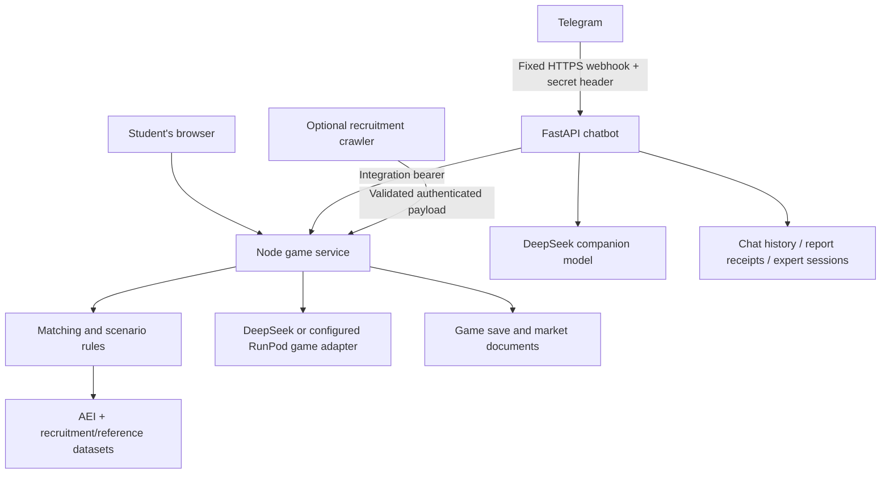

# KerjayaKu architecture

## Runtime services

The browser loads the Vite-built Three.js world from the Node service. Its
`/api/*` routes implement profiles, career matching, learning tasks, check-ins,
progress and mentor conversations. The server computes scores and priorities;
AI supplies explanations and structured task text.

Telegram delivers updates to a separate FastAPI service at
`https://kerjayaku-telegram.onrender.com/telegram/webhook`. It validates Telegram's
secret header and calls the Node integration API with a shared bearer token.
The Node production entry point does not start Python.

## Source and data boundaries

- `src/game/sources/` and `src/game/static/`: live client code and game assets.
- `src/game/server/`: API, deterministic rules and server-only model calls.
- `src/chatbot/app/`: messaging routing, model calls, storage and game client.
- `runpod/provider.js`: optional game inference transport, not a separate
  custom serverless handler. Python provider selection is independent.
- `data/`: runtime AEI measures, official signals, imputed/mock values and public
  recruitment references; `data/game/` holds ignored local player data.
- `src/data/`: processing code, source mappings and historical inputs.
- `docs/reference/`: archived upstream/reference material, not runtime assets.
- `docs/verification/`: recorded screenshots and reports, not a second app.

## Deployment and persistence

Current verified production uses separate free Render Node and Python services
from `main`. The current inference provider is DeepSeek. Legacy provider
adapters and development configuration remain in the source tree.

Free instances have ephemeral filesystems. The game's JSON save and the bot's
SQLite database are not restart-safe there. The opt-in
[`render.persistent.yaml`](../render.persistent.yaml) configures two paid Starter
services and independent disks. It has not been enabled. The game also supports
PostgreSQL/AWS storage when configured; Python supports its AWS storage backend.
See [deployment and webhook verification](render-deployment.md).

## Interpretation and verification limits

AI-use evidence is separate from hiring-demand evidence. Scenario parameters
represent assumptions, and synthetic or imputed values are not observations.
Learning progress is a preparation indicator rather than a proficiency certificate.
Local regression results, cloud health checks, actual Telegram commands and GPU
rendering are different kinds of evidence and must be reported separately.
